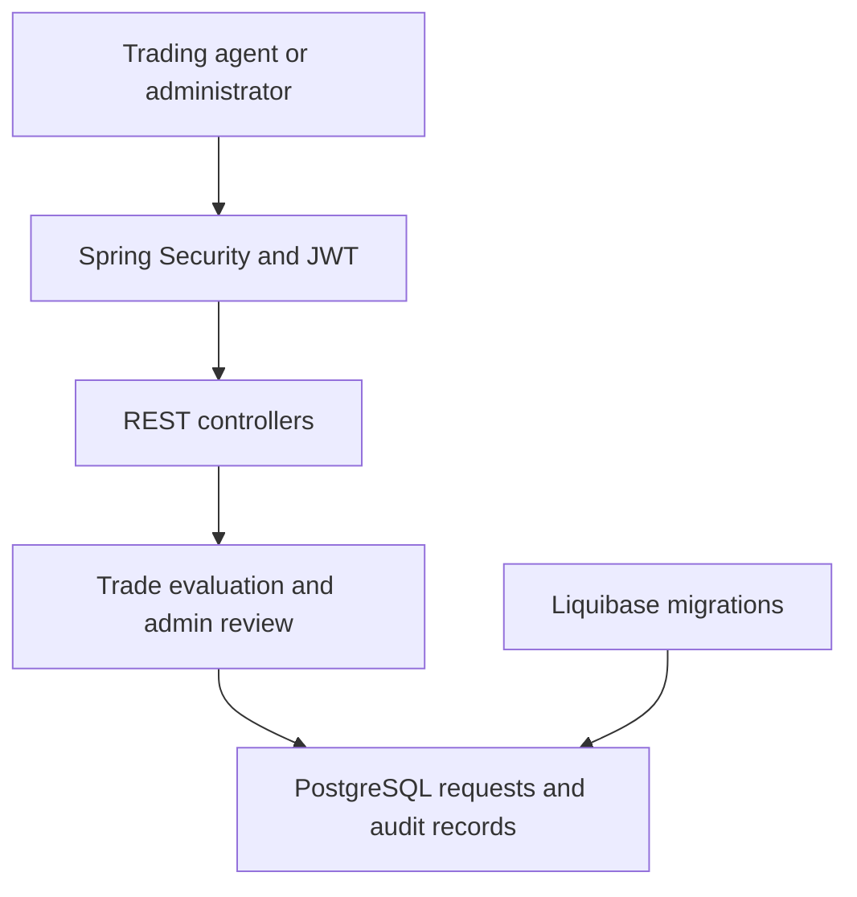

# SecureTrade Access API architecture

Spring Security authenticates requests before they reach the controllers. The service layer applies decision rules and ownership checks. PostgreSQL persists trade requests and compliance audit records.
